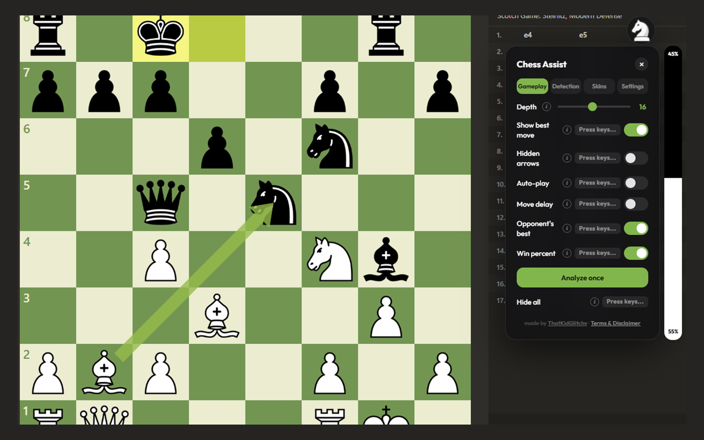
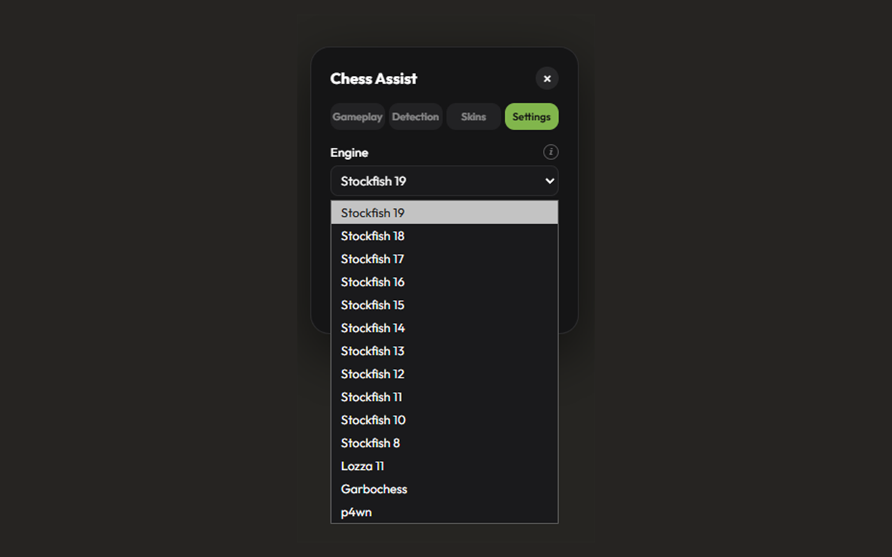
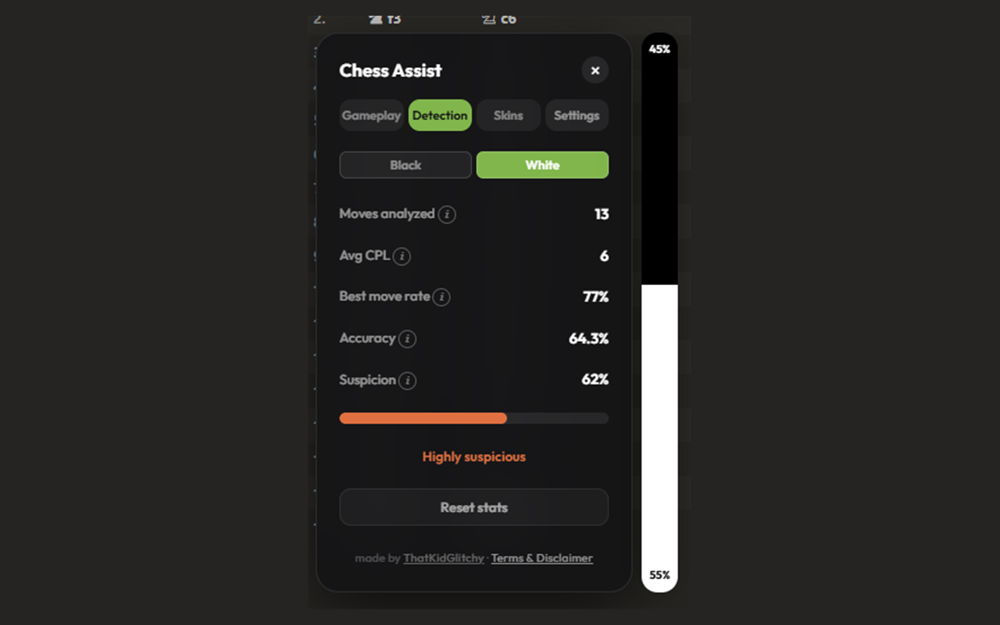
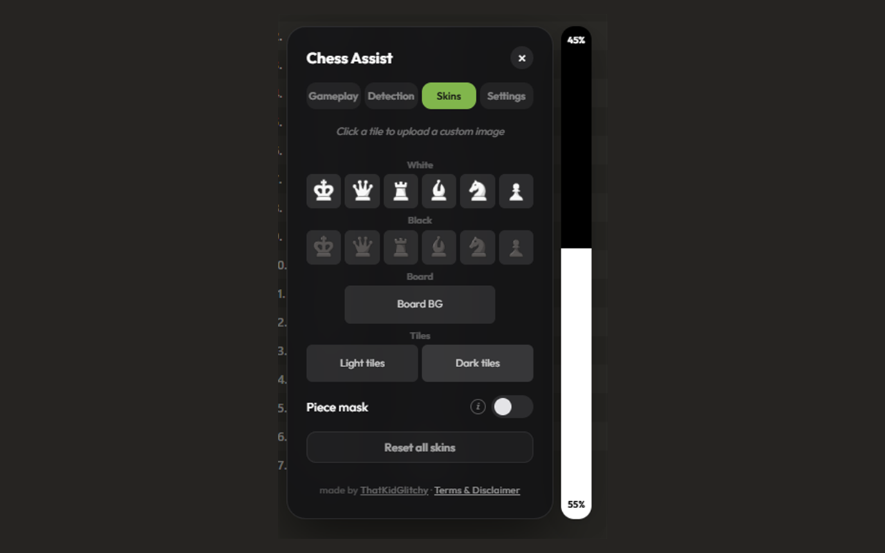

# Chess Assist

Stockfish chess engine hack for chess.com. Desktop and mobile versions included.

**Current version: v1.3.5**



| Settings | Detection | Skins |
|---|---|---|
|  |  |  |

## Features

- **Multiple engines** — pick from 14 engines at runtime: Stockfish 8, 10, 11, 12, 14, 15, 16, 17, 18, 19, Lozza 1/3/11, and Garbochess
- **Per-engine depth memory** — each engine remembers its own search depth independently
- **Loading overlay with progress %** — full-screen spinner shows which engine is loading and real-time download percent
- **Auto-play** — engine plays the best move automatically each turn with anti-repetition to avoid draw loops
- **Move delay** — random delay before auto-play moves (0–15s) to simulate human thinking time
- **Best move arrows** — green arrow showing the engine's top pick
- **Hidden arrows** — subtle square shading instead of visible arrows for a less obvious look
- **Opponent's best move** — red arrow predicting the opponent's best reply
- **Win percent eval bar** — live vertical bar showing win probability from Stockfish evaluation
- **Voice narration** — speaks the best move each turn through your headphones in chess-SAN style ("knight G one to F three", "bishop takes queen on F seven", "castle kingside", "pawn E seven to E eight, promote to queen, checkmate"). Nothing shows on screen, so anyone watching your screen can't spot it. Dark voice picker, speed / volume sliders, Say-once button to replay the last move, and a dedicated keybind on desktop
- **Cheat detection** — real-time CPL, accuracy %, best move rate, and suspicion gauge
- **Opponent / You toggle** — track the opponent's accuracy or your own with full move history
- **Re-analyze game** — replay all moves through the engine to recalculate stats
- **Custom piece skins** — upload custom images for any piece (both colors)
- **Board themes** — custom board background image
- **Tile overlays** — separate images for light and dark squares
- **Adjustable depth** — engine search depth from 1 to 24 (default 16, auto-caps at 12 for pure-JS engines)
- **Customizable keybinds** — assign hotkeys to any toggle, with a one-click Reset keybinds button
- **Save settings toggle** — turn persistence off to make session-only changes; wipes localStorage cleanly when disabled
- **Tabbed UI** — Gameplay / Detection / Skins / Settings in a draggable panel
- **Pre-game arrows** — arrows and eval render on the bot-selection / setup board; auto-play stays off until the real game starts
- All settings persist in localStorage across page reloads (toggles, depth, per-engine depth, delay, keybinds, detection target, engine selection)
- All skins persist in localStorage across sessions
- Runs entirely client-side, no data sent anywhere

## Install — pick one

> ⚠️ **chess.com only.** Chess Assist is built against chess.com's DOM and game API. It will not work on lichess.org, chess24, chesstempo, or any other chess site.

There are three ways to install Chess Assist. Pick whichever works for you:

### Use warning and disclaimer

By downloading, installing, or using Chess Assist, you acknowledge that you have read and agree to the [Use Warning and Disclaimer](Chess-Assist-Disclaimer.md)

### 1. Tampermonkey

Install from Greasy Fork or directly from GitHub:

- **Desktop:** [chess-assist-tampermonkey.js](https://raw.githubusercontent.com/ThatKidGlitchy/chess-hacks/main/chess-assist-tampermonkey.js)
- **Mobile:** [chess-assist-tampermonkey-mobile.js](https://raw.githubusercontent.com/ThatKidGlitchy/chess-hacks/main/chess-assist-tampermonkey-mobile.js)

Open the raw link with Tampermonkey installed and it will offer to install the script. Updates automatically.

### 2. Chrome Extension (Official)

Install directly from the Chrome Web Store:

**[Chess Assist on the Chrome Web Store](https://chromewebstore.google.com/detail/lndpjblmeoajilkhmdppoalcfdpoiaic)**

Extension ID: `lndpjblmeoajilkhmdppoalcfdpoiaic`

The extension version runs multi-threaded Stockfish via a Chrome offscreen document, so it's noticeably faster than the Tampermonkey / bookmarklet single-threaded builds. Auto-updates through the Web Store.

If you'd rather load it unpacked, download [`chess-assist-extension.zip`](https://github.com/ThatKidGlitchy/chess-hacks/releases/latest/download/chess-assist-extension.zip) from [releases](https://github.com/ThatKidGlitchy/chess-hacks/releases) and load it at `chrome://extensions` with Developer mode on.

### 3. Bookmarklet

See below under each version for the bookmarklet loader URL.

## Desktop (chess-assist.js)

### Usage — Loader Bookmarklet

Always runs the latest version from GitHub:

1. Create a bookmark in your browser with this URL:
   ```
   javascript:void(fetch('https://raw.githubusercontent.com/ThatKidGlitchy/chess-hacks/main/chess-assist.js').then(r=>r.text()).then(eval))
   ```
2. Open a game on chess.com, click the bookmarklet
3. Click the knight icon to open the panel

### Alternative — paste in console

1. Open a game on chess.com
2. Open browser DevTools (F12 → Console)
3. Paste the contents of `chess-assist.js` and press Enter
4. Click the knight icon to open the panel

## Mobile / iOS Safari (chess-assist-mobile.js)

Same features as desktop (skins, live win percent eval bar, engine detection, voice narration) except no keybind system and no hide-all toggle (mobile doesn't use keyboards). Touch-optimized with larger targets (48px bubble, 28px switches, 22px slider thumbs), close button on panel, slightly longer timeouts for slower devices.

### Usage — Loader Bookmarklet

Always runs the latest version from GitHub:

1. Create a bookmark in Safari with this URL:
   ```
   javascript:void(fetch('https://raw.githubusercontent.com/ThatKidGlitchy/chess-hacks/main/chess-assist-mobile.js').then(r=>r.text()).then(eval))
   ```
2. Open a chess.com game in Safari, tap the bookmarklet
3. Tap the knight icon to open the panel

### Alternative — paste in console

On desktop Safari or any browser with console access, paste the contents of `chess-assist-mobile.js` directly.

## Engines

The desktop version (`chess-assist.js`) ships with 14 engines selectable from the Settings tab, all hosted from the companion [chess-engines](https://github.com/ThatKidGlitchy/chess-engines) repo via jsDelivr. All builds are single-threaded so they work on chess.com (which doesn't set the COOP/COEP headers needed for `SharedArrayBuffer`).

| Engine | Kind | Max depth | Notes |
|--------|------|-----------|-------|
| Stockfish 19 | WASM (lite NNUE) | 24 | Default; strongest |
| Stockfish 18 | WASM (lite NNUE) | 24 | |
| Stockfish 17 | WASM (lite NNUE) | 24 | |
| Stockfish 16 | WASM (lite NNUE) | 24 | |
| Stockfish 15 | WASM | 24 | |
| Stockfish 14 | WASM | 24 | |
| Stockfish 12 | WASM | 24 | First NNUE build |
| Stockfish 11 | WASM | 24 | Last classical build |
| Stockfish 10 | WASM | 24 | |
| Stockfish 8 | asm.js | 24 | Pure asm.js, 64 MB fixed memory |
| Lozza 11 | Pure JS (NNUE) | 12 | |
| Lozza 3 | Pure JS | 12 | |
| Lozza 1 | Pure JS | 12 | Classical |
| Garbochess | Pure JS | 12 | Gary Linscott's engine with a UCI wrapper |

Each engine falls back to ASM.js when its WASM wrapper references features (like `SharedArrayBuffer`) that fail in a plain Worker. MultiPV up to 3 with anti-repetition logic to avoid draw loops; pure-JS engines run MultiPV 1 only.

## Arrow Colors

| Arrow | Color | Meaning |
|-------|-------|---------|
| Green | #96bc4b | Your best move |
| Red | #e04040 | Opponent's best reply |

## Notes

- Works on chess.com only (relies on chess.com DOM structure)
- The script runs entirely client-side — no data sent anywhere
- Use the loader bookmarklet to always get the latest version automatically
- Both arrow types can be shown simultaneously (different SVG layers)
- Thank you "Chess helper (chess.com)" on the Chrome web store for the UI theme!

