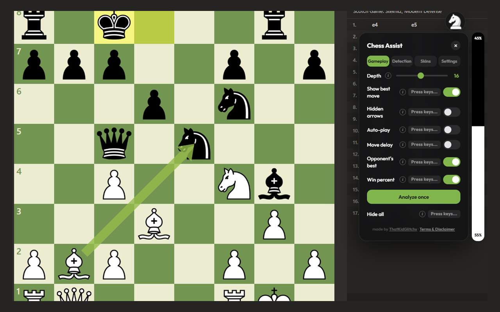
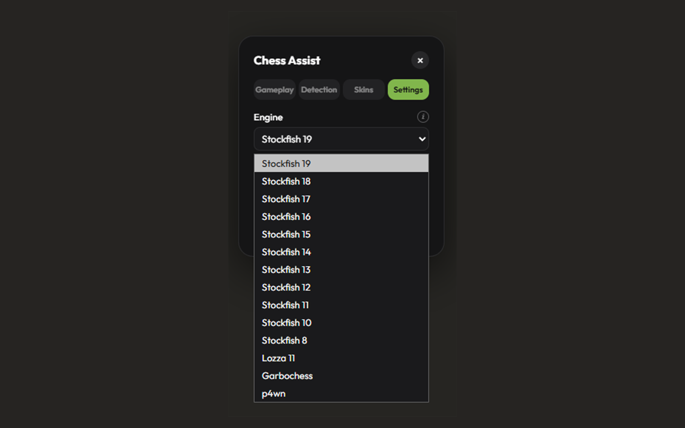
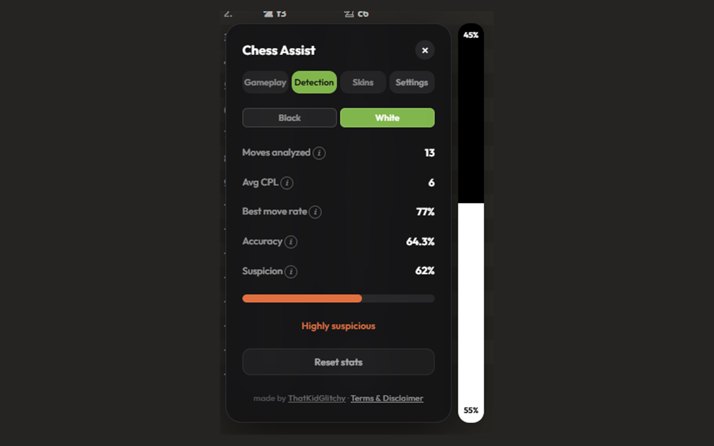
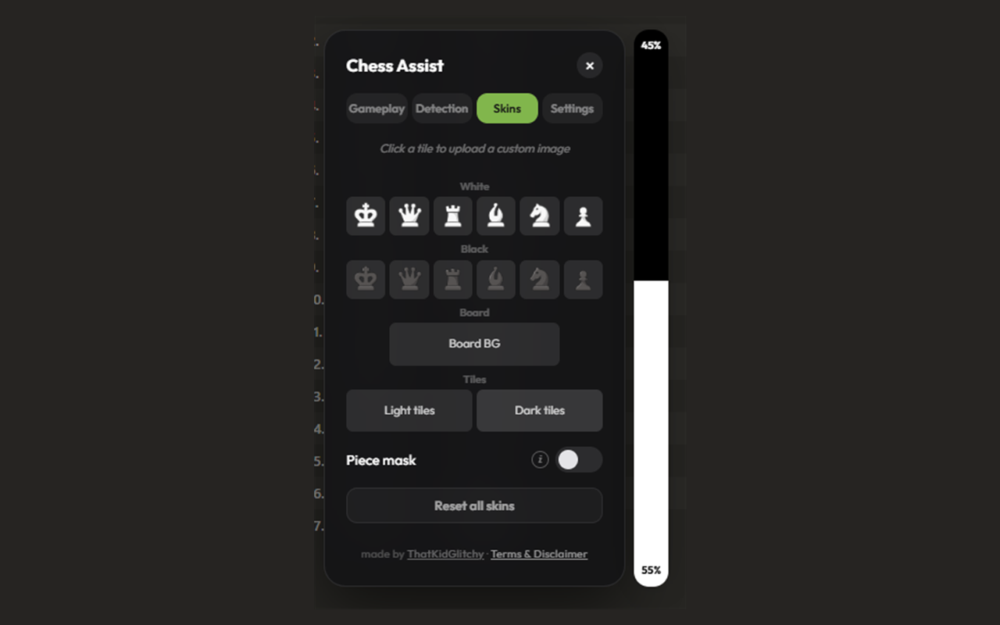

# Chess Assist

Multi-engine assistant for **chess.com and [chesskid.com](https://www.chesskid.com)** with auto-play, best-move arrows, cheat detection, custom skins + boards, whole-site themes, a 16-language UI, and a move explainer that narrates your moves in plain English. 10 engines ship with the script: Stockfish 19 / 18 / 17 / 16 / 11 / 10 / 8, Lozza 11, Garbochess, and p4wn. Desktop and mobile versions included.

**Current version: v1.5.0**



| Settings | Detection | Skins |
|---|---|---|
|  |  |  |

## Features

- **Works on chess.com and chesskid.com** — same panel, same features, same arrows and eval bar on both sites
- **Multiple engines** — 10 engines at runtime: Stockfish 19/18/17/16/11/10/8, Lozza 11, Garbochess, and p4wn
- **Move explainer (beta)** *(desktop)* — new narrator on the Gameplay tab that comments on your moves — and optionally your opponent's — in plain language as you play
- **Accent color picker** *(desktop)* — Settings → Appearance. Pick any color for the UI accent (panel highlights, arrows, buttons, eval bar). Click the swatch for the native color wheel, click Change to open it again, or type a hex into the box (the "#" is locked so you only edit the 6 characters after it); Reset puts it back to Chess Green
- **Whole-site Themes page** *(desktop)* — 4th page of the Skins tab with full site themes (AMOLED, Night Owl, Frutiger Aero, Pink, and more). Click a tile to apply the theme across the whole site; Clear theme returns to the default look
- **Ad blocker** *(desktop)* — toggle in Settings. Blocks chess.com's ad slots so the board and panel have room to breathe
- **Feedback link** *(desktop)* — one-click link in Settings to the feedback / bug-report form
- **Interface in 16 languages** *(desktop + mobile)* — English, Español, Français, Deutsch, Português, Русский, Italiano, Polski, Nederlands, Türkçe, 简体中文, 日本語, 한국어, Українська, हिन्दी, العربية. First-run language picker; non-English dictionaries fetched on demand from CDN (relies on standard HTTP caching — no in-script localStorage cache, so new translations ship instantly). Translated labels that would be wider than the English equivalent scale their font-size down automatically so long words never break the panel layout
- **Streamer mode** *(desktop)* — shows the best move as a small floating text pill ("F1 TO C4") instead of an arrow on the board. Drag it anywhere, resize, position it behind your stream overlay or off your OBS capture area
- **Premade piece sets** *(desktop + mobile)* — 300+ open-source piece sets from Lichess, Rhosgfx, Sharechess, and NikAgs on the Skins tab's second page. Click to apply all 12 pieces at once
- **Board themes** *(desktop + mobile)* — 150+ open-source board themes from NikAgs and Sharechess on the Skins tab's third page. Click a tile and the whole board gets reskinned — solid-color boards, wood, grass, leather, cardboard, clouds, pixel art, and more
- **UI opacity slider** *(desktop)* — fade the whole helper UI from 100% down to 5% so it never gets in the way of the board
- **Hidden arrows darkness slider** *(desktop)* — tune how strong the shaded-square hint is
- **Paginated tabs** *(desktop)* — Gameplay (3 pages), Skins (4 pages), Settings (2 pages). Pager arrows + dots at the top keep each tab short while fitting more features, with a slide-fade animation between pages
- **Per-engine depth memory** — each engine remembers its own search depth independently
- **Loading overlay with progress %** — full-screen spinner shows which engine is loading and real-time download percent
- **Auto-play** — engine plays the best move automatically each turn with anti-repetition to avoid draw loops
- **Move delay** — random delay before auto-play moves (0–15s) to simulate human thinking time
- **Best move arrows** — green arrow showing the engine's top pick
- **Hidden arrows** — subtle square shading instead of visible arrows for a less obvious look
- **Opponent's best move** — red arrow predicting the opponent's best reply
- **Win percent eval bar** — live vertical bar showing win probability from the selected engine's evaluation
- **Voice narration** — speaks the best move each turn through your headphones in chess-SAN style ("knight G one to F three", "bishop takes queen on F seven", "castle kingside", "pawn E seven to E eight, promote to queen, checkmate"). Nothing shows on screen, so anyone watching your screen can't spot it. Dark voice picker, speed / volume sliders, Say-once button to replay the last move, and a dedicated keybind on desktop
- **Cheat detection** — real-time CPL, accuracy %, best move rate, and suspicion gauge
- **Opponent / You toggle** — track the opponent's accuracy or your own with full move history
- **Re-analyze game** — replay all moves through the engine to recalculate stats
- **Custom piece skins** — upload custom images for any piece (both colors)
- **Board themes** — custom board background image
- **Tile overlays** — separate images for light and dark squares
- **Adjustable depth** — engine search depth from 1 to 24 (default 16, auto-caps at 12 for pure-JS engines). A small "≈ N ELO" subtitle under the slider shows a rough playing-strength estimate at that depth (community ballpark, not official — looser for Lozza / Garbochess / p4wn)
- **Hide icon persistence** *(desktop)* — hiding the helper sticks across page reloads. While hidden, auto-play / arrows / voice stay paused until you unhide. Forgot your hide keybind? Open the browser console after loading and it prints the current bind
- **Customizable keybinds** — assign hotkeys to any toggle, with a one-click Reset keybinds button
- **Save settings toggle** — turn persistence off to make session-only changes; wipes localStorage cleanly when disabled
- **Tabbed UI** — Gameplay / Detection / Skins / Settings in a draggable panel
- **Pre-game arrows** — arrows and eval render on the bot-selection / setup board; auto-play stays off until the real game starts
- All settings persist in localStorage across page reloads (toggles, depth, per-engine depth, delay, keybinds, detection target, engine selection, accent color, site theme, ad-block preference)
- All skins persist in localStorage across sessions
- Runs entirely client-side, no data sent anywhere

## Install — pick one

> ℹ️ **chess.com and chesskid.com only.** Chess Assist is built against chess.com's and chesskid.com's DOM and game APIs. It will not work on lichess.org, chess24, chesstempo, or any other chess site.

There are three ways to install Chess Assist. Pick whichever works for you:

### Use warning and disclaimer

By downloading, installing, or using Chess Assist, you acknowledge that you have read and agree to the [Use Warning and Disclaimer](Chess-Assist-Disclaimer.md)

### 1. Tampermonkey

Install from Greasy Fork or directly from GitHub:

- **Desktop:** [chess-assist-tampermonkey.js](https://raw.githubusercontent.com/ThatKidGlitchy/chess-hacks/main/chess-assist-tampermonkey.js)
- **Mobile:** [chess-assist-tampermonkey-mobile.js](https://raw.githubusercontent.com/ThatKidGlitchy/chess-hacks/main/chess-assist-tampermonkey-mobile.js)

Open the raw link with Tampermonkey installed and it will offer to install the script. The script is matched to both `*://*.chess.com/*` and `*://*.chesskid.com/*`, so it loads automatically on either site. Updates automatically.

### 2. Chrome Extension (Official)

Install directly from the Chrome Web Store:

**[Chess Assist on the Chrome Web Store](https://chromewebstore.google.com/detail/lndpjblmeoajilkhmdppoalcfdpoiaic)**

Extension ID: `lndpjblmeoajilkhmdppoalcfdpoiaic`

The extension version runs multi-threaded Stockfish via a Chrome offscreen document, so it's noticeably faster than the Tampermonkey / bookmarklet single-threaded builds. Auto-updates through the Web Store.

If you'd rather load it unpacked, download [`chess-assist-extension.zip`](https://github.com/ThatKidGlitchy/chess-hacks/releases/latest/download/chess-assist-extension-1.5.0.zip) from [releases](https://github.com/ThatKidGlitchy/chess-hacks/releases) and load it with Developer mode on at `chrome://extensions` (Chrome / Brave / Opera / Arc) or `edge://extensions` (Microsoft Edge).

### 3. Bookmarklet

See below under each version for the bookmarklet loader URL.

## Desktop (chess-assist.js)

### Usage — Loader Bookmarklet

Always runs the latest version from GitHub:

1. Create a bookmark in your browser with this URL:
   ```
   javascript:void(fetch('https://raw.githubusercontent.com/ThatKidGlitchy/chess-hacks/main/chess-assist.js').then(r=>r.text()).then(eval))
   ```
2. Open a game on chess.com or chesskid.com, click the bookmarklet
3. Click the knight icon to open the panel

### Alternative — paste in console

1. Open a game on chess.com or chesskid.com
2. Open browser DevTools (F12 → Console)
3. Paste the contents of `chess-assist.js` and press Enter
4. Click the knight icon to open the panel

## Mobile / iOS Safari (chess-assist-mobile.js)

Same features as desktop (three-page Skins tab with 300+ premade piece sets and 150+ board themes, custom skin upload, live win percent eval bar, cheat detection, voice narration, UI opacity, hidden-arrows darkness slider, 16-language UI with first-run picker, Engine / Appearance / Session settings sections) except no keybind system, no hide-all toggle, and no streamer mode (mobile doesn't use keyboards and phones don't stream). Touch-optimized with larger targets (48px bubble, 28px switches, 22px slider thumbs), close button on panel, slightly longer timeouts for slower devices. Premade / boards catalog falls back to XHR on iOS Safari so iPads with a keyboard load correctly.

### Usage — Loader Bookmarklet

Always runs the latest version from GitHub:

1. Create a bookmark in Safari with this URL:
   ```
   javascript:void(fetch('https://raw.githubusercontent.com/ThatKidGlitchy/chess-hacks/main/chess-assist-mobile.js').then(r=>r.text()).then(eval))
   ```
2. Open a chess.com or chesskid.com game in Safari, tap the bookmarklet
3. Tap the knight icon to open the panel

### Alternative — paste in console

On desktop Safari or any browser with console access, paste the contents of `chess-assist-mobile.js` directly.

## Engines

The desktop version (`chess-assist.js`) ships with 10 engines selectable from the Settings tab, all hosted from the companion [chess-engines](https://github.com/ThatKidGlitchy/chess-engines) repo via jsDelivr. All builds are single-threaded so they work on chess.com and chesskid.com (neither site sets the COOP/COEP headers needed for `SharedArrayBuffer`).

| Engine | Kind | Max depth | Notes |
|--------|------|-----------|-------|
| Stockfish 19 | WASM (lite NNUE) | 24 | Default; strongest |
| Stockfish 18 | WASM (lite NNUE) | 24 | |
| Stockfish 17 | WASM (lite NNUE) | 24 | |
| Stockfish 16 | WASM (lite NNUE) | 24 | |
| Stockfish 11 | WASM | 24 | Last classical build |
| Stockfish 10 | WASM | 24 | |
| Stockfish 8 | asm.js | 24 | Pure asm.js, 64 MB fixed memory |
| Lozza 11 | Pure JS (NNUE) | 12 | |
| Garbochess | Pure JS | 12 | Gary Linscott's engine with a UCI wrapper |
| p4wn | Pure JS | 4 | Douglas Bagnall's "5k chess" — deliberately weak, for low-ELO practice |

Each engine falls back to ASM.js when its WASM wrapper references features (like `SharedArrayBuffer`) that fail in a plain Worker. MultiPV up to 3 with anti-repetition logic to avoid draw loops; pure-JS engines run MultiPV 1 only.

## Arrow Colors

| Arrow | Color | Meaning |
|-------|-------|---------|
| Green | your accent color (default #81B64C) | Your best move |
| Red | #E04040 | Opponent's best reply |

The best-move arrow follows your accent color setting (Settings → Appearance → accent color picker), so changing the accent restyles the arrow, the eval bar, panel highlights, and button accents to match.

## Notes

- Works on chess.com and chesskid.com (relies on each site's DOM structure)
- The script runs entirely client-side — no data sent anywhere
- Use the loader bookmarklet to always get the latest version automatically
- Thank you "Chess helper (chess.com)" on the Chrome web store for the UI theme!
